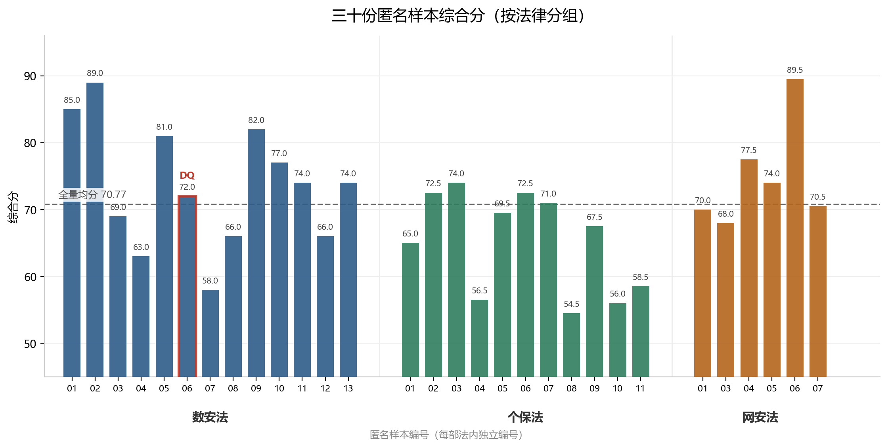

# 三法法律 AI 盲评

> 中国《数据安全法》《个人信息保护法》《网络安全法》三法规则拆解评测
> 6 个通用模型 + 1 个专业法律助手 Agent + 1 个独立裁判模型 · Harness 隔离编排 · 47 个独立窗口 · 30 份匿名样本 · 6 维评分

## 概览

| 项目       | 内容                                                                              |
| -------- | ------------------------------------------------------------------------------- |
| **测什么**  | 中国三法条文的规则拆解——决策树、条款映射表、可执行 YAML、覆盖账本                                            |
| **怎么测**  | 30 份匿名样本、6 维加权评分、47 个隔离窗口，分数锁定后才揭盲                                              |
| **结果概览** | 综合分均分 **70.77**；1 份触发一票否决(DQ)；13 组同模型双模式配对 **6 : 7**，平均差 -1.12，方向不一致            |
| **怎么用**  | 复用流程看 [`protocol/`](protocol/README.md)，复用 YAML 体检看 [`tools/`](tools/README.md) |

## 这是什么

本仓库记录一次针对《数据安全法》《个人信息保护法》《网络安全法》的多模型法律规则拆解评测。

评测对象不是普通问答，而是完整交付物：

- 条文忠实转写；
- 术语统一；
- 决策树；
- 条款-规则映射表；
- 可执行 YAML；
- 覆盖账本与自检。

公开版只保留方法、评分框架和匿名聚合结果；不公开原始样本、模型身份映射、平台运行日志和完整模型输出。

> **免责声明**
> 本仓库是 AI 输出质量的**评估方法与匿名化评测结果**，不构成法律意见，
> 也不构成对任何模型、平台或供应商的推荐或贬损。法条理解与合规判断请以
> 官方文本及执业律师意见为准。评测结果与日期、版本、提示词和输入模式高度相关，不可外推为长期结论。

**English abstract.** A blind (identity-blinded) evaluation of how LLMs decompose
China's Data Security Law, Personal Information Protection Law and Cybersecurity Law
into reviewable decision trees and executable YAML. 30 anonymized samples,
a 6-dimension rubric with one-vote-veto for fabricated citations, 47 isolated
evaluation windows, and same-model dual-mode pairing. Results are descriptive only.
This is a methodological pilot, not a definitive or statistically powered benchmark.

## 评测架构

本评测不是单模型跑一次，而是由多层角色和隔离机制组成：

```text
拆解侧（7 个）：6 个通用模型 + 1 个法律助手 Agent
裁判侧（1 个）：独立裁判模型 —— 只评分，不参与拆解、不产出样本

拆解 → 隔离编排 → 匿名样本 → 独立裁判 → 评分锁定 → 身份映射 → 同模型配对
```

- **6 个通用模型**：参与条文转写、决策树、映射表和 YAML 拆解；
- **1 个专业法律助手 Agent**：作为领域专用形态参与拆解；其底层选用的推理档位与某个通用模型同源，但在本评测中**作为独立形态单列**，用于横向对比；
- **1 个独立裁判模型**：只评匿名样本，不看模型名、平台名和历史分数；**不参与拆解，也不产出样本**，因此不出现在匿名映射表中；
- **1 个编排平台（Harness，外部工具）**：提供独立窗口与工作区隔离，本仓库未包含其代码；
- **1 套编排协议（本仓库 [`protocol/`](protocol/README.md)）**：规定材料投放、三阶段执行顺序、中断恢复与身份映射时机；
- **1 个机械体检工具（本仓库 [`tools/`](tools/README.md)）**：YAML 可解析性、条款号真伪、quote 逐字、占位符残留的自动核查；
- **人工复核**：抽查条款号、quote、义务强度、但书、YAML 和覆盖账本。

拆解侧不是简单"跑 7 次"，而是分了两组纵向对照：

- **档位对照**：选取其中一个模型，分别选择两个不同档位参与拆解；
- **形态对照**：选取其中一个模型，在最高推理档位下分别以**纯对话形态**和**领域 Agent 形态**参与拆解。

这两组纵向对照，加上 6 个通用模型之间的横向对比，构成本评测的三个比较维度。

本次参与拆解与裁判的模型，均为测试时可用的最新一代模型；其中通用模型多取最高推理档位，另含 2 个低倍率档位作为档位对照。

所有参与角色使用独立工作区，避免上下文和身份信息串扰。

## 为什么做盲评

如果评审时先看到模型名、平台名或历史分数，评分很容易被品牌印象锚定。

因此本评测采用：

- 匿名样本编号；
- 工作区隔离；
- 分法独立评分；
- 分数锁定后再恢复模型身份；
- 同模型双模式配对；
- 人工抽查复核。

## 评测范围

| 法律      | 样本数 | 说明                     |
| ------- | ---:| ---------------------- |
| 数据安全法   | 13  | 提供原文 + 自行检索            |
| 个人信息保护法 | 11  | 提供原文 + 自行检索            |
| 网络安全法   | 6   | 提供原文 + 自行检索；含 2025 修正版 |
| 合计      | 30  | 1 份 DQ，29 份有效评分        |

> **关于网络安全法的样本编号**：样本号为 01、03–07，**缺 02**。
> 02 号原分配给某模型在「自行检索」模式下交付的一份**法律原文文本快照**——该模型同时交付了快照与拆解文档，匿名化编号时快照被误当成独立样本、占用了一个编号。盲评前经人工核查发现并移出评分集合，**对应的拆解文档按原编号正常参评**；为避免打乱既有对照关系，未重新编号。
> 这类错误机械统计可能发现不了（窗口数、样本数都能对上），主要靠人工核查。

## 评分框架

六个维度，1–5 分：

| 维度         | 权重  | 关注点               |
| ---------- | ---:| ----------------- |
| 条文忠实度与术语一致 | 25% | 逐字转写、条款号、义务强度、但书  |
| 决策树结构与覆盖   | 25% | 树目录、深度、叶子、覆盖率、账本  |
| 逻辑正确性      | 20% | 条件方向、且/或、例外挂载     |
| 可追溯性       | 15% | 条款号、quote 逐字、覆盖账本 |
| 可执行性       | 10% | YAML 解析、字段定义、动作类型 |
| 诚实度        | 5%  | 不确定标注、不编造、不虚增     |

综合分：

```text
综合分 = Σ(维度得分 × 权重) ÷ 5 × 100
```

### DQ：一票否决

出现以下情况时，样本标记为 DQ，不参与排名：

- 编造条款号；
- 占位符残留；
- 关键交付缺失；
- 编造另一部法条文；
- 覆盖账本严重失实。

DQ 分数只代表半成品参考分，不代表有效交付质量。

## 执行规模

一次完整评测共使用 **47 个独立窗口**：**45 个新建窗口 + 2 个长期协作窗口**。

| 环节                         | 窗口数                | 产出                         |
| -------------------------- | ------------------:| -------------------------- |
| 条文拆解                       | 37（全部新建）           | 29 份成品 + 1 份半成品 + 7 个无输出失败 |
| 盲评                         | 7（全部新建）            | 三法评分结果（其中 3 个窗口中途中断）       |
| 结果映射与报告                    | 1（新建）              | 模型映射、同模型配对、最终分析报告          |
| 指令 / 评分标准 / 匿名化 / 隔离工作区准备等 | 2（长期协作）            | 拆解指令、评分标准、匿名包、隔离工作区、失败复盘   |
| **合计**                     | **47**（45 新 + 2 老） |                            |

**拆解成品率 29 / 37 = 78.4%**（另有 1 份半成品、7 个窗口无输出）。

失败窗口按事实记录，与模型能力分开计分，不计入模型排名。

## 隔离与过程控制

- 参与盲评与结果映射的 **8 个新建窗口，工作区完全独立**；
- 即使是共享文件，每个工作区各持一份副本，**全程无工作区交叉、无上下文串扰**；
- 每份拆解使用全新窗口，每份盲评使用全新窗口；
- 汇总、映射、配对分别由独立窗口完成；
- 模型侧不接触裁判评分与历史结果，裁判侧不知道模型身份；
- 分数锁定后才启用身份映射；
- 每份样本输出 checkpoint，避免中断导致全量重跑（属执行纪律，非指令条款，详见 [`protocol/`](protocol/README.md)）。

**中断与恢复**：7 个盲评窗口中，3 个因物理原因（电脑锁屏/休眠导致的连接中断与进程停止）中途停止且未产出评分结果，损耗约 **5000 万 Token**；此后由长期协作窗口协助检查并制定 checkpoint 与断点续评方案，最终 30 份样本全部完成评分。

## 成本

> 仅公开结构性结论，不公开金额、积分与账号信息。

- 盲评阶段累计消耗 **3.3 亿+ Token**，其中包含上述约 **5000 万 Token** 的中断损耗；
- 该数字**不含** 37 个拆解窗口的消耗——拆解分散在不同平台与不同计费口径下，无法统一折算；
- 成本差异主要来自**平台计费方式**，而不是模型能力；
- 同一批任务，不同平台的单份产出成本差异可达数倍；
- **无输出的窗口同样消耗额度**，因此应看「每份有效交付的成本」，而不是「每份产出的成本」。

## 关键发现

- 30 份评分样本中 1 份 DQ，29 份有效；
- 全量均分 70.77，中位数 70.75，最高 89.5，最低 54.5；
- 13 组同模型双模式配对：6 组提供原文更高，7 组自行检索更高，方向不一致；
- 同模型配对平均总分差仅 -1.12，不能得出某一模式整体更好；
- 主要问题不是错字，而是条款号、义务强度、但书、覆盖账本和 YAML 一致性。



分法均分：数据安全法 **73.54**（n=13）、网络安全法 **74.92**（n=6）、个人信息保护法 **65.23**（n=11）。

个人信息保护法的平均分明显低于另两部。一个可能的解释是：其「例外与但书」密度最高，更容易在①忠实度和③逻辑上失分；该解释为观察性推断，未做统计检验。

其余三张图（六维雷达、输入模式对比、分布箱线）见 [`results/`](results/README.md)。

## 相关文章

- **工程复盘**｜47 个隔离窗口、3.3 亿 Token 是怎么做出来的 —— [掘金](https://juejin.cn/post/7706833656823939098)
- **发现与结论**｜大模型拆法律条文，最常错在哪 —— [知乎](https://zhuanlan.zhihu.com/p/2104301425626968921)

> 两篇面向不同读者：一篇讲**怎么做**（工程流程与踩坑），一篇讲**发现了什么**（错误类型与结论）。

## 本仓库包含

```text
.
├── README.md                       本文件：方法、范围、结果和边界
├── 一页案例_公开版.md               项目一页案例
├── instructions/                   给模型的输入：三法拆解指令
│   ├── 拆解指令_数据安全法_盲评版_v1.0.md
│   ├── 拆解指令_个人信息保护法_盲评版_v1.0.md
│   └── 拆解指令_网络安全法_盲评版_v1.0.md
├── rubrics/                        给裁判的量表
│   ├── 评分标准_三法通用_v1.0.md     六维权重、分档、DQ、三层裁判流程
│   └── 考点清单/
│       ├── 考点清单_数据安全法.md     20 项
│       ├── 考点清单_个人信息保护法.md  27 项
│       └── 考点清单_网络安全法.md     15 项
├── protocol/                       盲评协议：谁看什么、按什么顺序、中断怎么恢复
│   ├── README.md                    协议总说明（材料投放 / 两层隔离 / 三阶段 / 恢复）
│   ├── 01_盲评评审官指令.md          裁判材料可见性与证据纪律
│   ├── 02_汇总窗口指令.md            汇总不得重打分、不得推断身份
│   ├── 03_同模型配对分析指令.md       配对 join 规则与解释边界
│   └── figures/                     工作区隔离示意图
├── tools/                          机械体检工具
│   ├── yaml_audit.py                 YAML/条款号/quote/占位符自动核查
│   └── README.md                     用法与边界说明
└── results/                        匿名聚合结果
    ├── 匿名汇总表.csv               30 份样本 × 六维得分 × DQ 标记
    ├── figures/                     四张结果图（坐标轴仅样本编号）
    └── README.md                    列说明、统计口径与图
```

> 考点清单只用于覆盖性核对，**不是条款号答案**；判定一律以官方原文为准。

## 如何复用

本仓库不公开原始样本与模型输出，但**量表、协议与工具可以直接拿走用**：

| 你想做的事                            | 从哪里开始                                                                                 |
| -------------------------------- | ------------------------------------------------------------------------------------- |
| 复用六维评分量表                         | [`rubrics/评分标准_三法通用_v1.0.md`](rubrics/评分标准_三法通用_v1.0.md)                              |
| 复用盲评流程（材料投放 / 两层隔离 / 三阶段 / 中断恢复） | [`protocol/README.md`](protocol/README.md)                                            |
| 复用机械体检脚本                         | [`tools/yaml_audit.py`](tools/yaml_audit.py)，用法见 [`tools/README.md`](tools/README.md) |
| 查看匿名得分与图表                        | [`results/`](results/README.md)                                                       |

### 最省事的入口：机械体检脚本

如果你在用大模型生成**配置、规则或表单**，最先能复用上的是这个脚本——
它把"看起来对、实则错"的机械问题全部自动化：

```bash
pip install pyyaml python-docx

# 在仓库根目录执行
python tools/yaml_audit.py 你的文件.md --strict --json report.json
```

> 脚本面向**包含 YAML 代码块的 Markdown 文件**；裸 `.yaml`、JSON 或表单定义需先转成对应格式，否则会读到 0 个块。

它检查：YAML 能否解析、必填字段是否齐全、枚举值是否越界、**条款号是否真实存在**、
引用是否**逐字**匹配原文、占位符是否残留、`rule_id` 是否重复。

> 它不判断法律推理对错——那部分仍需人工。详见 [`tools/README.md`](tools/README.md)。

## 不公开内容

- 原始模型输出；
- 模型身份映射；
- 平台运行日志与运行过程截图；
- 账号、成本、积分明细；
- 完整内部复盘文档。

> 例外：[`protocol/figures/`](protocol/figures/) 保留一张工作区列表示意图，不含任何模型输出与身份信息。

## 适用场景与方法边界

本评测的定位是**方法学示范（pilot）**，不是权威选型结论。以下场景可作为**参考输入**使用：

- 法律 AI 选型（作为参考输入之一，不能单独据此定选型）；
- 供应商评测（可复用其量表与盲评流程）；
- 合规规则库验收（覆盖账本与 YAML 检查方法）；
- 模型上线前质量闸门（DQ 一票否决规则）；
- FDE 场景下的客户方案验证。

样本量小、分法不均（网安法仅 6 份：部分模型在该任务上出现输出被回收并生成防御性回答话术，甚至可能窗口冻结，多次重新开启新窗口尝试均无法获取），当前样本量不足以支持模型排名或选型结论。

上述为运行现象记录，未对具体机制做归因。

## 成功与失败都保留

本评测不只展示成功案例，也保留：

- 完整交付样本；
- 部分失败：章节缺失、占位符、YAML 错误；
- 运行异常：中断、超时、导出失败；
- DQ 样本：某模型在数安法（提供原文模式）任务中运行约 44 分钟后**未产出结果文档**；参与评分的半成品由其工作流残片拼接而成，因占位符残留与章节缺失触发一票否决。

失败样本不删除，用于定位交付质量与工程流程问题；运行异常与模型能力分开记录。

## 限制

样本量小、模型版本和平台差异混杂；结论只作描述性对比，不作统计显著性结论。评测结果与日期、版本、提示词和输入模式相关，不能外推为长期结论。

## 作者

独立完成评测设计、匿名化与隔离、评分执行、配对分析和报告撰写。

- GitHub：[@Tina-6688](https://github.com/Tina-6688)
- 仓库：[multi-llm-legal-eval](https://github.com/Tina-6688/multi-llm-legal-eval)
