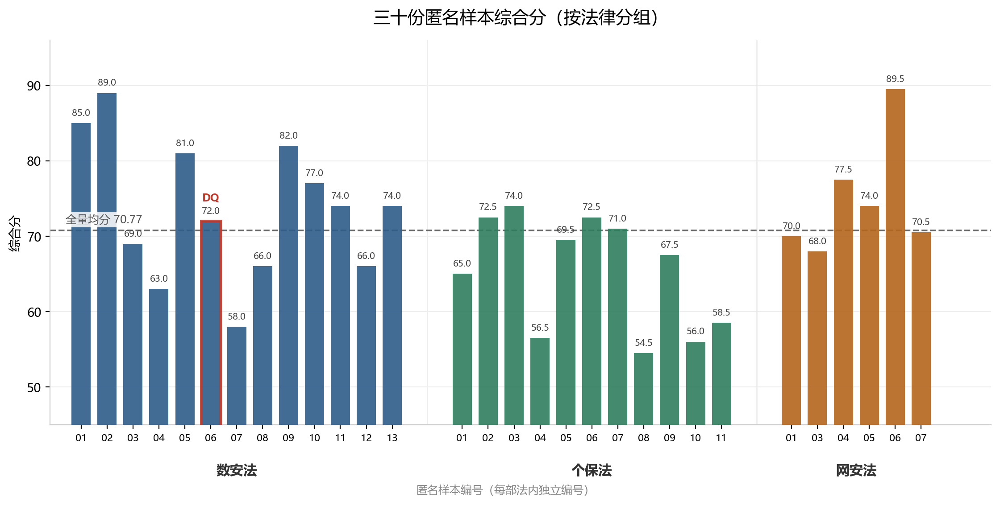
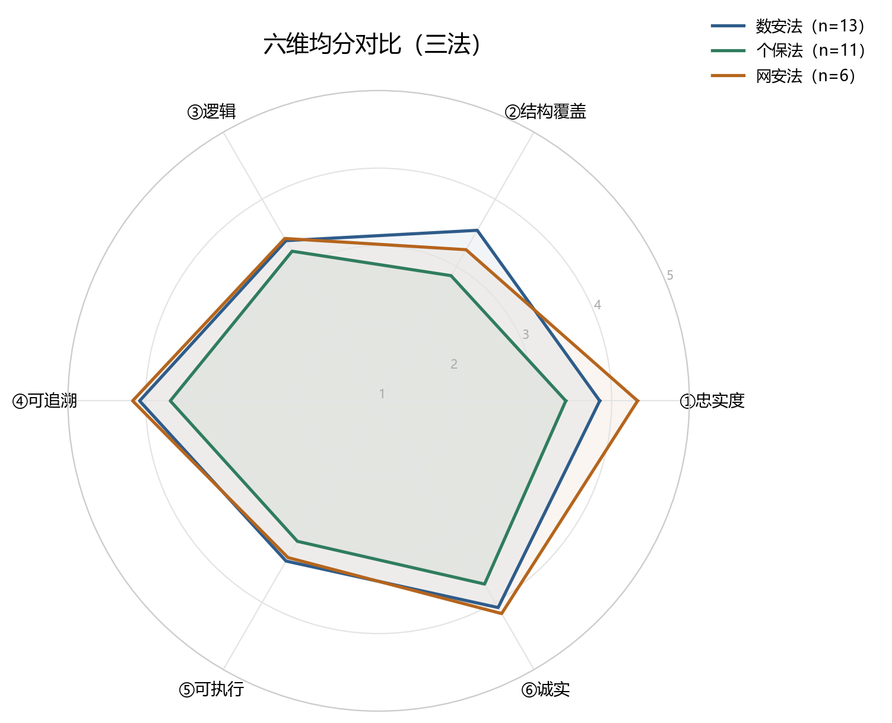
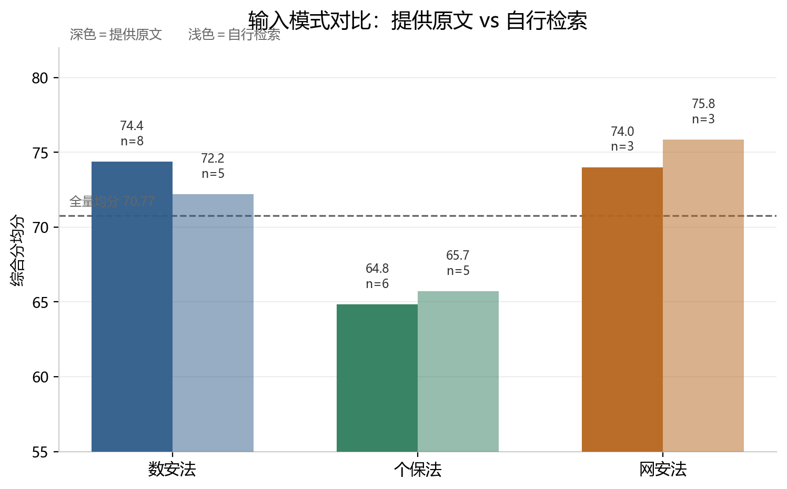
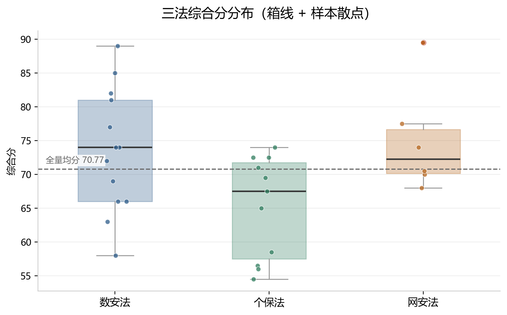

# 匿名汇总表说明

`匿名汇总表.csv` 记录 30 份样本的六维得分与 DQ 标记，**不含任何模型或平台身份信息**。

## 列说明

| 列 | 含义 |
| --- | --- |
| 法律 | 数据安全法 / 个人信息保护法 / 网络安全法 |
| 样本 | 该法内的匿名编号（样本01、样本02…） |
| 模式 | 提供原文 / 自行检索 |
| ①忠实度 … ⑥诚实 | 六维得分，1–5 分 |
| 综合分 | Σ(维度得分 × 权重) ÷ 5 × 100，保留 1 位小数 |
| DQ | 是否触发一票否决；非「无」即表示该样本不参与排名 |
| 主要证据 | 扣分的主要依据（条款号错引、树节点问题、quote 命中情况等） |

## 全量统计

- 样本 30 份，其中 DQ 1 份，有效 29 份；
- 综合分：均分 **70.77**，中位数 **70.75**，最高 **89.5**，最低 **54.5**；
- 模式分布：提供原文 **17** 份、自行检索 **13** 份；
- 分法分布：数据安全法 13、个人信息保护法 11、网络安全法 6；
- 唯一 DQ 样本为数据安全法「样本06」（占位符残留 + 三节未交付），总分 72.0 但被一票否决。

### 为什么网络安全法缺 02 号

网络安全法样本号为 01、03–07（缺 02），编号按原始盲评包顺序保留，未重排。

02 号**不是一份独立的模型产出**。某个模型在「自行检索」模式下同时交付了两份文件：一份检索到的法律原文文本快照，一份拆解结果文档。匿名化编号阶段，那份文本快照被误当成独立样本占用了一个编号；盲评实施前经人工核查发现并移出评分集合，对应的拆解结果文档按原编号正常参评。为避免打乱既有对照关系，未重新编号。

它记录的是一个真实的过程风险：**同一窗口的多份交付物，在匿名化时容易被打散误计为多个样本。** 这类错误靠机械统计发现不了——窗口数、样本数都能对上——只能靠人工核查。

## 结果图

四张图，坐标轴只用样本编号，不出现模型或平台身份。

### 图 1｜三十份样本综合分（按法律分组）

红框为触发一票否决的 DQ 样本（数安法 06）。

### 图 2｜六维均分对比

### 图 3｜输入模式对比

深色为「提供原文」，浅色为「自行检索」。三部法方向不一致：数安法提供原文略高，个保法与网安法自行检索略高。

### 图 4｜三法分数分布

箱线 + 个体样本散点，看离散度与离群值。

## 关于配对分析

README 中的「13 组同模型双模式配对」结论，需要**模型身份映射**才能复现；本表刻意不含该映射。

本表可以支撑的复核：

- 六维得分与综合分是否满足权重公式；
- DQ 样本到底出了什么问题；
- 不同法律、不同模式下的分数分布与离散度。

## 评分口径

权重、分档、DQ 规则与三层裁判流程见 [`../rubrics/评分标准_三法通用_v1.0.md`](../rubrics/评分标准_三法通用_v1.0.md)。
